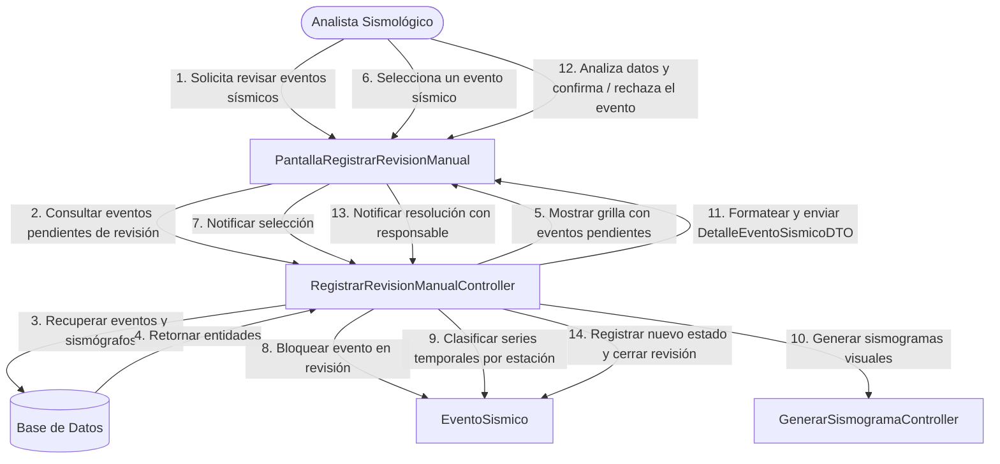
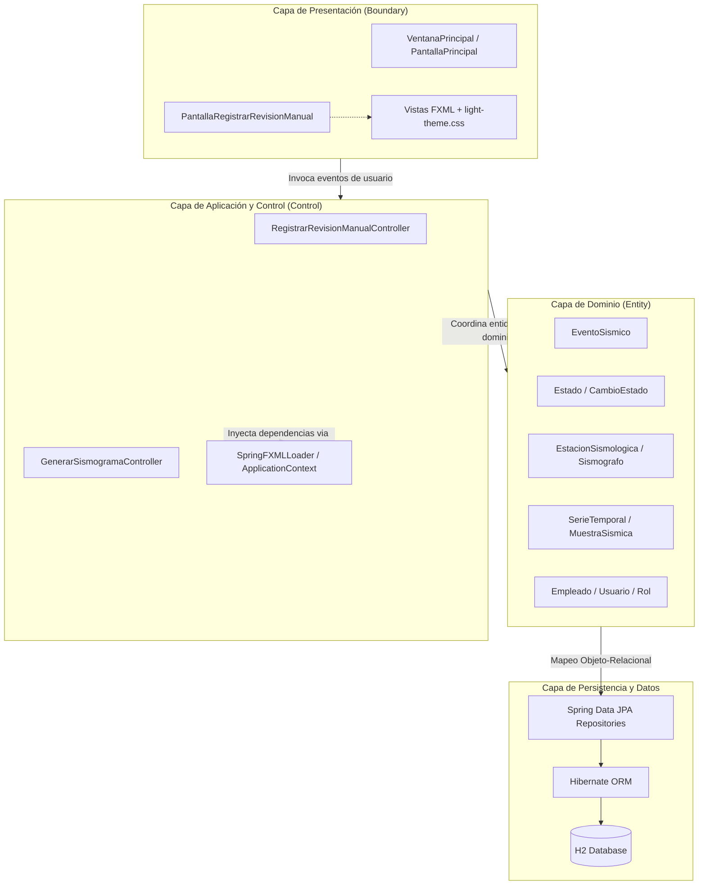
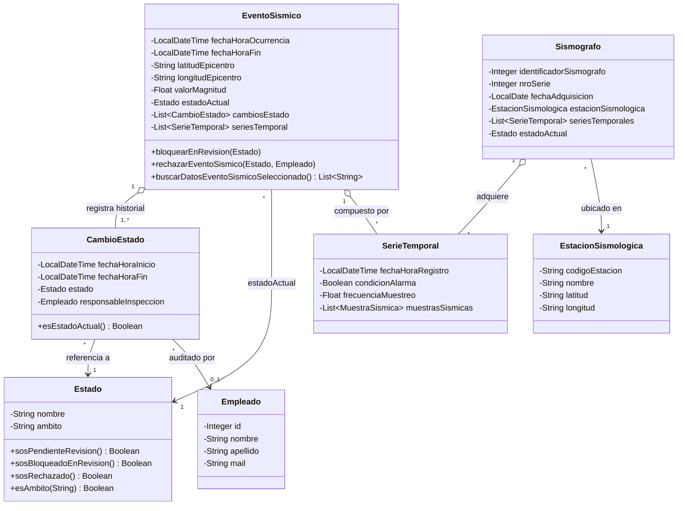
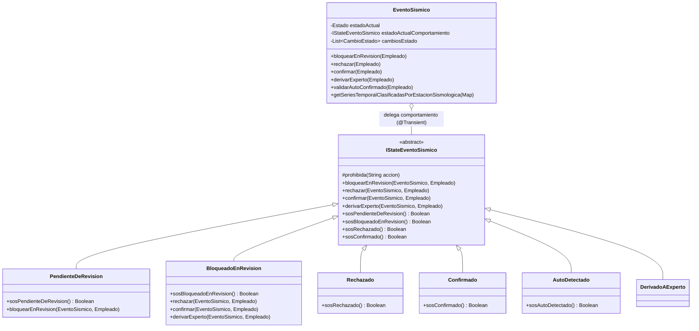
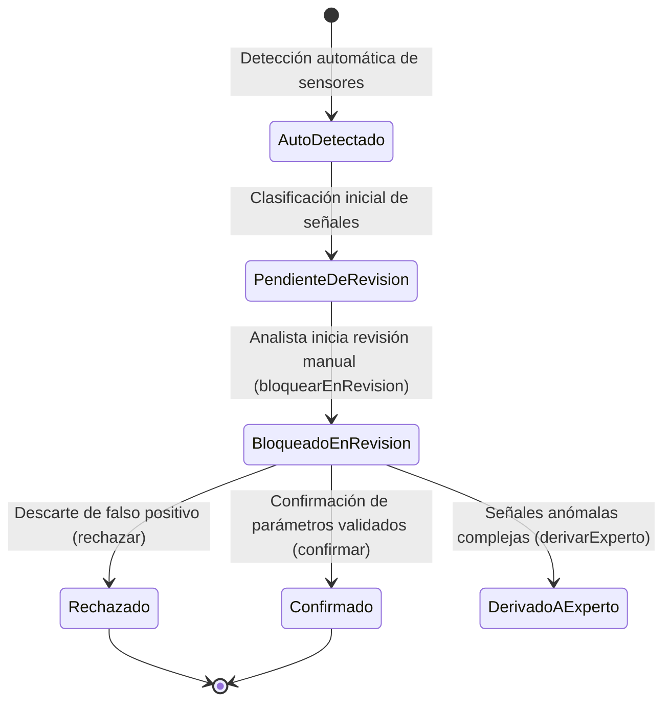

# 🌍 Red Sísmica Nacional - Sistema de Gestión y Supervisión de Eventos Sísmicos

Proyecto Práctico Integrador desarrollado para la cátedra **Diseño de Sistemas de Información (DSI)** de la **Universidad Tecnológica Nacional - Facultad Regional Córdoba (UTN-FRC)**.

---

## 📌 Contexto del Proyecto y Evolución de Entregas

El proyecto modela el dominio de una **Red Sísmica Nacional**, cuyo propósito es la captura continua de señales telúricas a través de estaciones sismológicas, el procesamiento de series temporales y la intervención de analistas para la supervisión humana de eventos detectados.

El desarrollo se articuló en dos etapas iterativas:

- **[Primera Entrega (branch: `primera-entrega`)](https://github.com/Cristulo/tpaiSismos/tree/primera-entrega):** Implementación basal del caso de uso principal utilizando la arquitectura en capas y el patrón **BCE (Boundary-Control-Entity)**, con un manejo de estados respaldado en persistencia relacional tradicional.
- **[Segunda Entrega (branch: `segunda-entrega`)](https://github.com/Cristulo/tpaiSismos/tree/segunda-entrega):** Evolución orientada a la excelencia en diseño de software. Se refactorizó la lógica condicional hacia el **Patrón State (GoF)**, se reasignaron responsabilidades bajo patrones **GRASP (Experto en Información)** y se integró un sistema de diseño estandarizado para la interfaz gráfica en JavaFX.

---

## 🎯 Caso de Uso Central: "Registrar Revisión Manual de Evento Sísmico"

El flujo de trabajo implementa la supervisión humana de las detecciones automáticas de la red:

### Principios aplicados en el flujo:
1. **Patrón Controlador (GRASP):** `RegistrarRevisionManualController` actúa como mediador de la interacción, delegando la lógica de negocio a los objetos de dominio sin contener reglas operativas propias del evento.
2. **Desacoplamiento con DTO:** La vista consume `DetalleEventoSismicoDTO`, evitando acoplar la tecnología de interfaz (JavaFX) a las entidades gestionadas por el ORM.
3. **Inmutabilidad y Trazabilidad:** Los cambios de estado no sobreescriben datos históricos; generan instancias de `CambioEstado` con marca temporal y auditoría del empleado operador.

---

## 🏛 Arquitectura en Capas y Patrón BCE

El sistema implementa una separación rigurosa de responsabilidades basada en el patrón **Boundary-Control-Entity (BCE)**, integrado con el contenedor de inversión de control de Spring Boot:

---

## 📐 Diagrama de Clases - Primera Entrega

Estructura de entidades relacionales modeladas para soportar el caso de uso antes de la introducción del patrón de comportamiento:

---

## 🔄 Patrón de Diseño State (GoF) - Segunda Entrega

En la segunda entrega se reemplazó la lógica condicional por el **Patrón State**, otorgándole polimorfismo dinámico al ciclo de vida del evento sísmico.

### Diagrama de Clases del Patrón State

### Máquina de Transición de Estados

### Mecanismos de Diseño Destacados:
- **Protección por Defecto:** La clase base `IStateEventoSismico` arroja por defecto `IllegalStateException("Acción no permitida desde <Estado>")` ante cualquier transición inválida, blindando la integridad del negocio.
- **Coexistencia Híbrida Limpia (JPA + GoF):** Se mantiene `@ManyToOne Estado estadoActual` para garantizar la persistencia relacional con integridad referencial (claves foráneas) y se utiliza `@Transient IStateEventoSismico estadoActualComportamiento` para la ejecución del polimorfismo en tiempo de ejecución, sincronizado mediante `@PostLoad`.
- **GRASP Experto en Información:** La clasificación y agrupamiento de series temporales por estación sismológica fue trasladada desde el controlador hacia `EventoSismico`, ya que es este último quien conoce sus propias series.

---

## 🏛 Resumen Académico

| Concepto de Diseño | Aplicación Concreta en el Proyecto |
| :--- | :--- |
| **BCE (Boundary-Control-Entity)** | Separación estricta entre vistas JavaFX/FXML (Boundary), controladores de caso de uso (Control) y entidades JPA/Hibernate (Entity). |
| **Patrón State (GoF)** | Desacoplamiento de las transiciones operativas de `EventoSismico` en clases concretas polimórficas (`PendienteDeRevision`, `BloqueadoEnRevision`, etc.). |
| **Experto en Información (GRASP)** | Filtrado y asignación de series temporales encapsulada en la entidad que posee los datos (`EventoSismico`). |
| **Creador (GRASP)** | Creación y administración del historial de cambios de estado encapsulada en la entidad contenedora. |
| **Bajo Acoplamiento** | Uso de `DetalleEventoSismicoDTO` para transferir información a la UI sin exponer modelos relacionales de persistencia. |
| **Auditoría e Inmutabilidad** | Modelado temporal con `CambioEstado`, registrando inicio, fin y responsable sin sobreescribir la traza histórica. |

---

*Cátedra de Diseño de Sistemas de Información (DSI) — Universidad Tecnológica Nacional, Facultad Regional Córdoba (UTN-FRC).*
